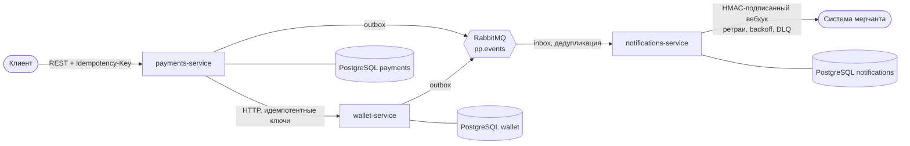

# payments-platform

Учебная платёжная платформа из трёх микросервисов на **TypeScript · NestJS · PostgreSQL**.
Цель проекта — показать, как строятся надёжные денежные потоки: двойная запись, идемпотентность,
защита от гонок, transactional outbox, inbox-дедупликация и доставка вебхуков с ретраями.



| Сервис                              | Ответственность                      | Ключевые решения                                                                               |
| ----------------------------------- | ------------------------------------ | ---------------------------------------------------------------------------------------------- |
| **wallet-service** (`:3001`)        | Счета, переводы, резервы (holds)     | Двойная запись, `SELECT … FOR UPDATE` в едином порядке, CHECK-инварианты в БД, идемпотентность |
| **payments-service** (`:3002`)      | Жизненный цикл платежа поверх wallet | Конечный автомат, compare-and-set переходов, дообработка после сбоев                           |
| **notifications-service** (`:3003`) | Подписки и доставка вебхуков         | Inbox, `SKIP LOCKED` + lease, backoff с джиттером, HMAC, защита от SSRF                        |

Общий код — в `libs/`: `contracts` (типы событий), `nest-kit` (идемпотентность, ошибки, деньги), `outbox` (запись и релей в RabbitMQ).
Решения и компромиссы описаны в [ADR](docs/adr).

## Быстрый старт

Нужны Node 22+, pnpm и Docker.

```bash
pnpm install
export WALLET_KEY_SECRET=$(openssl rand -hex 24)   # секрет ключей payments→wallet; хранить и не менять
docker compose --profile app up -d --build   # Postgres, RabbitMQ и три сервиса
./scripts/smoke.sh                            # платёж от пополнения до возврата
```

Swagger: <http://localhost:3001/docs>, <http://localhost:3002/docs>, <http://localhost:3003/docs>.
Режим разработки: `pnpm infra:up`, затем `pnpm build` и `pnpm --filter @pp/wallet-service dev` (переменные — в `.env.example`).

## Пример

```bash
# 1. Счета и пополнение (суммы — строки в копейках)
curl -X POST :3001/accounts -H 'content-type: application/json' -d '{"ownerId":"u1","currency":"RUB"}'
curl -X POST :3001/accounts/$PAYER/deposits -H "idempotency-key: $(uuidgen)" \
     -H 'content-type: application/json' -d '{"amount":"100000"}'

# 2. Платёж: авторизация резервирует средства, capture списывает, refund возвращает
curl -X POST :3002/payments -H "idempotency-key: $(uuidgen)" -H 'content-type: application/json' \
     -d '{"payerAccountId":"…","merchantAccountId":"…","amount":"30000","currency":"RUB"}'
curl -X POST :3002/payments/$ID/capture
curl -X POST :3002/payments/$ID/refund
```

Повтор любого запроса с тем же `Idempotency-Key` безопасен: вернётся прежний результат, деньги не задвоятся.
Тот же ключ с другими параметрами — `409 IDEMPOTENCY_KEY_REUSED`.

## Проверка

```bash
pnpm lint && pnpm build && pnpm test
```

Тесты используют **реальные** PostgreSQL и RabbitMQ через Testcontainers (нужен Docker):

- wallet — переводы, холды, гонки (20 параллельных списаний с баланса на 10), встречные переводы без deadlock, инвариант «сумма балансов = 0» и «баланс = сумма проводок», закрытый системный счёт, переполнение баланса;
- payments — полный цикл, недопустимые переходы, обрыв связи с wallet, сверка зависших платежей, проверка счёта мерчанта, HTTP-клиент wallet (408/429/5xx, обрыв тела ответа);
- notifications — дедупликация, фильтры, ретраи, dead-letter и ручной retry, подпись, запрет редиректов, два воркера без дублей, SSRF-гвард при соединении;
- `libs/outbox` — два релея без дублей, порядок при сбое, аренда, таймаут confirm;
- `e2e/` — три сервиса и RabbitMQ вместе: платёж → резерв → outbox → брокер → inbox → подписанный вебхук; отдельно — `mandatory`-публикация, пересоздание подписки после удаления очереди, повторы с задержкой.

`./scripts/smoke.sh` поднимает локальный приёмник вебхуков и **падает**, если подписи неверны, итоговое событие не пришло или в журнале есть `dead`.

## Структура

```
apps/wallet-service · payments-service · notifications-service
libs/contracts · nest-kit · outbox
e2e/        сквозные тесты платформы
docs/adr/   архитектурные решения
```

## Ограничения (осознанные)

- Нет аутентификации и авторизации — на границе платформы ожидается API-gateway.
- Секреты вебхуков хранятся в БД открытым текстом (нужны для подписи); в продакшене — шифрование через KMS.
- Без аутентификации `Idempotency-Key` — общее для всех клиентов пространство: клиент, знающий чужой ключ, может занять его раньше. Внутренние ключи capture вынесены в недоступный клиенту алфавит (`#…`), а ключи payments→wallet выводятся HMAC-ом с секретом `WALLET_KEY_SECRET` и непредсказуемы. Платежи, созданные до введения HMAC (`key_version = 1`), продолжают использовать прежние предсказуемые ключи — иначе повтор незавершённой операции выполнил бы её дважды. Секрет менять нельзя. Полноценная привязка ключей к клиенту потребует аутентификации.
- SSRF: адрес проверяется при регистрации и при каждом соединении (IP-литералы, IPv4-mapped, NAT64, CGNAT и др.; DNS-резолв проверяется в `lookup` самого сокета). Вебхуки уходят напрямую (`node:http(s)`), без `HTTPS_PROXY`: через прокси проверка адреса на сокете защищала бы лишь адрес прокси, поэтому в окружениях с обязательным прокси нужен egress-шлюз. Не покрыты внутренние имена, резолвящиеся в публичные адреса.
- Системный счёт валюты сериализует пополнения этой валюты и ограничен по модулю (`BALANCE_LIMIT_EXCEEDED`); в боевой системе нужен реестр внешних счетов (см. ADR-0002).
- Холд, оставшийся после проигранной гонки повторов `authorize`, снимается best-effort: если wallet в этот момент недоступен, холд придётся снять вручную.
- Лимиты: сумма одной операции — до 12 цифр, баланс пользовательского счёта — до 5e12 минорных единиц; системный счёт валюты ограничен лишь диапазоном `bigint`.
- Таблицы `outbox_events`, `inbox_events`, `webhook_deliveries` не очищаются — нужна retention-джоба.
